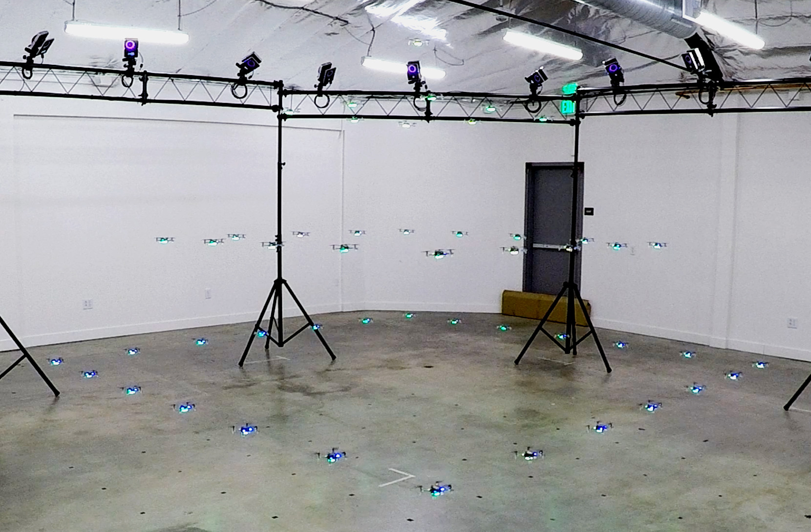
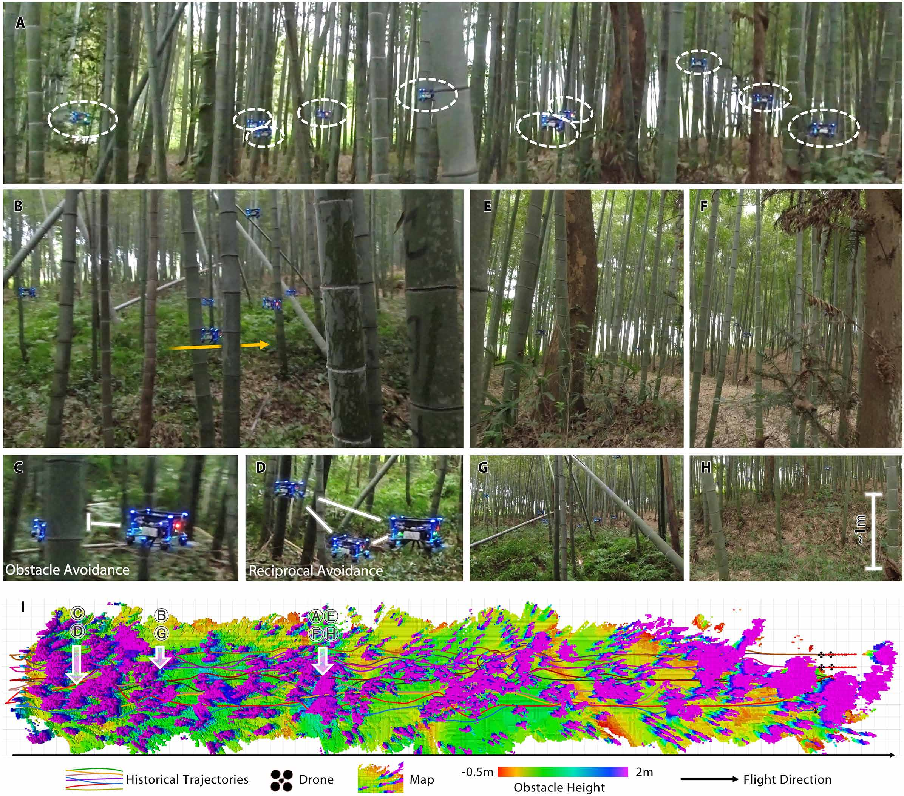
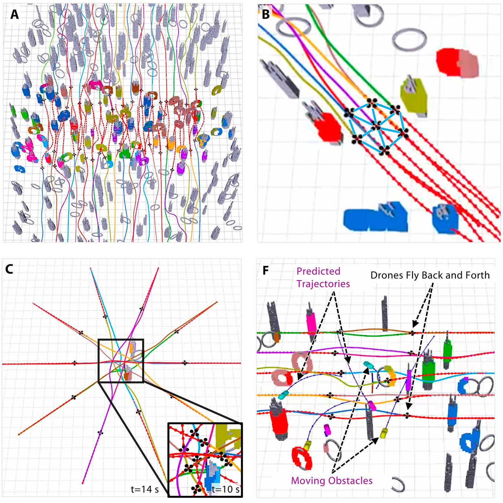

# Introdução aos enxames de drones

Material introdutório sobre arquitetura, algoritmos, eletrônica, aviônica, simulação e plataformas de pesquisa em enxames de drones.

O texto relaciona o funcionamento de cada aeronave à coordenação entre veículos. As equações e os exemplos têm finalidade didática; os estudos de caso apresentam soluções da literatura e as condições em que foram avaliadas. A seleção bibliográfica não constitui uma revisão sistemática, e as comparações de plataformas organizam critérios de projeto, sem ensaios próprios de custo ou desempenho.

<!-- 
<p align="center">
  
</p>

*capa de Science Robotics, maio de 2022, AAAS.* -->

## Conteúdo

- Conceitos de enxame, aplicações e restrições de operação.
- Arquitetura funcional e distribuição das decisões.
- Estimação de estado, controle de voo, formação, prevenção de colisões e alocação de tarefas.
- Comunicação e localização relativa.
- Eletrônica, aviônica e integração de componentes.
- Simulação e limites da transferência para o voo real.
- Estudos de caso: Crazyswarm, navegação em floresta de bambu, SwarmLab e SGBA.
- Seleção de plataformas conforme o objetivo de pesquisa e as competências de integração.
- Apêndices com siglas e notação matemática.

## Figuras do documento

### Voo em laboratório com localização externa

<p align="center">
  
</p>

O Crazyswarm combina controle a bordo e localização por captura de movimento. Fotografia reproduzida de Preiss et al., *Crazyswarm: A Large Nano-Quadcopter Swarm* (2017), p. 6. A descrição do experimento e sua referência estão no [capítulo de estudos de caso](docs/get-started-with-swarm-drone.tex).

### Navegação em floresta de bambu

<p align="center">
  
</p>

Registros de navegação de dez drones entre obstáculos, acompanhados do mapa e das trajetórias. Reprodução da Figura 3 de Zhou et al., *Swarm of micro flying robots in the wild* (2022), discutida no [capítulo de estudos de caso](docs/get-started-with-swarm-drone.tex).

### Coordenação em simulação

<p align="center">
  
</p>

Exemplos do *swarm playground*: navegação, formação, troca de posições e desvio de obstáculos móveis. Seleção e reorganização dos painéis A, B, C e F da Figura 8 de Zhou et al. (2022). A legenda detalhada e a referência estão no [capítulo de simulação](docs/capitulo-software-simulacao.tex). Esses painéis representam simulações.

## Estrutura do repositório

| Caminho | Conteúdo |
| --- | --- |
| [docs/get-started-with-swarm-drone.tex](docs/get-started-with-swarm-drone.tex) | Documento LaTeX principal, capítulos, apêndices e referências. |
| [docs/capitulo-software-simulacao.tex](docs/capitulo-software-simulacao.tex) | Capítulo de simulação, incluído pelo documento principal. |
| [docs/figures/](docs/figures/) | Figuras e imagens de apoio. |
| [docs/Makefile](docs/Makefile) | Comandos de compilação e limpeza. |
| [src/swarm_drone/](src/swarm_drone/) | Estrutura inicial do pacote Python. |

## Compilação do PDF

É necessário ter `make` e uma distribuição LaTeX com `latexmk`, `pdflatex` e os pacotes utilizados no documento. Uma instalação completa do TeX Live ou do MacTeX fornece esse ambiente. O pacote Python não é necessário para compilar o texto.

Na raiz do repositório, execute:

```sh
make -C docs
```

O PDF será gerado em `docs/get-started-with-swarm-drone.pdf`. O `latexmk` executa as passagens necessárias para atualizar o sumário, as citações e as referências internas.

Para remover os arquivos auxiliares, preservando o PDF:

```sh
make -C docs clean
```

Também é possível compilar diretamente dentro de `docs/`:

```sh
cd docs
latexmk -pdf -interaction=nonstopmode -halt-on-error get-started-with-swarm-drone.tex
```
